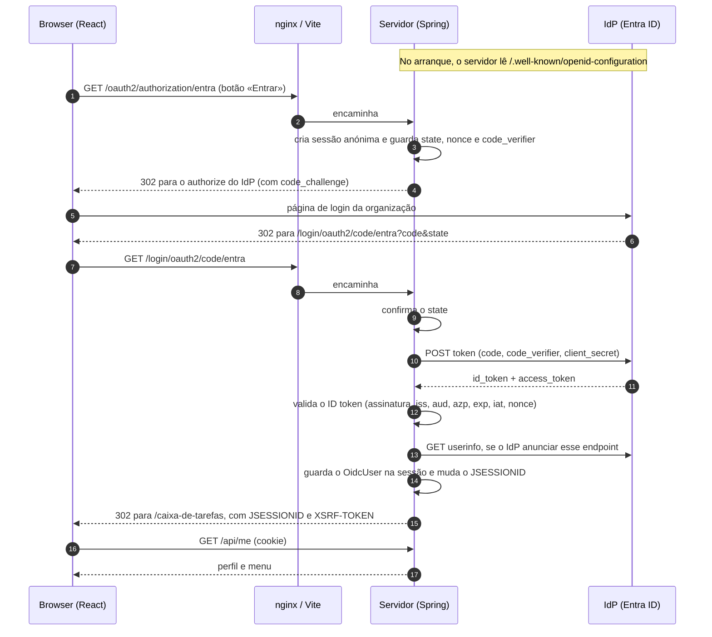

# Análise da autenticação e da autorização

## Estado final (2026-11)

A migração está feita no ramo `feature/UC01-change-entra-id-to-keycloak`, sobre `develop` (PR 60 a 64). A partir de «[Análise anterior à migração](#análise-anterior-à-migração-2026-11-23)», o documento é a análise que lhe deu origem: descreve código que já não existe, e as suas referências a linhas são as desse código.

**Como ficou.** O IdP só autentica, por OpenID Connect com o registo `oidc`. Do token leem-se `iss`, `sub`, `name`, `email` e `email_verified`, e nada mais. `SignIn` resolve (`iss`, `sub`) para um `identity.app_user`, e o principal tem o UUID da defiro em `getName()`. Papéis e estado leem-se da base de dados em cada pedido (`CurrentAccessFilter`, cache de 60 s). O servidor não tem nada específico do Keycloak: trocar de IdP é mudar quatro variáveis ([README](../README.md#sign-in)). O acesso por bearer foi retirado.

**O que foi confirmado a correr.** `KeycloakIT` importa o realm do `deploy/` num Keycloak 26.8.1 e faz a entrada e a saída completas. À mão, no browser, com o nginx (3000) e o Vite (5173): entrar, ver o menu, terminar a sessão, o IdP pedir credenciais outra vez, e continuar a ser a mesma pessoa depois de recriar o contentor do Keycloak. Não foi testado com outro IdP, nem atrás de um proxy TLS a sério (os cabeçalhos desse proxy são testados em `BehindAProxyIT`).

### Riscos da migração, um a um

| # | Risco | Estado | Onde |
|---|---|---|---|
| 1 | `oid` → `sub` | Resolvido. Nenhuma tabela guarda o `oid` ou o `sub`, só `external_identity`; as outras têm o UUID da defiro | `V2026_11_18_1__identity_people.sql`, `published_by` com chave estrangeira |
| 2 | Reaparecimento do `oid` | Resolvido. Não se lê; o que o token traga a mais não conta | `DefiroOidcUserServiceTest.onlyTheFiveClaimsReachDefiro` |
| 3 | `sub` instável ao ligar o Entra ID ao Keycloak | **Por resolver, na configuração do Keycloak**: a conta nova tem de ser associada à existente. Sem isso, a pessoa entra com uma conta nova e sem papéis, porque quem já tem conta não é ligado outra vez pelo email | `SignInIT.aPersonAlreadyLinkedToAnotherAccountIsNotLinkedAgain` |
| 4 | Recriar o realm muda os `sub` | Resolvido em desenvolvimento, com o id da Sofia fixo no realm. Numa instalação, os ids dos utilizadores têm de ser conservados | `defiro-realm.json`, `KeycloakIT.theAccountIsLinkedByIssuerAndSubject` |
| 5 | `varchar(36)` | Resolvido: `subject` e `issuer` são `text` | `V2026_11_18_1__identity_people.sql` |
| 6 | `published_by` imutável | Resolvido: guarda o UUID da defiro, que nunca muda | `V2026_11_19_3__engine_specification_versions.sql` |
| 7 | O servidor não arranca com o IdP em baixo | **Mantém-se**, e está no README. No compose, `web` e `web-dev` esperam pelo Keycloak e pelo Postgres, e `up -d --wait` serve quem arranca o servidor à mão | `deploy/compose.yaml` |
| 8 | Emissor único | Resolvido em desenvolvimento: `http://localhost:8081` para o browser e para o servidor, que corre no anfitrião (`KC_HOSTNAME`). O README diz o que fazer se o servidor passar a contentor | `deploy/compose.yaml` |
| 9 | Onde o Keycloak põe as claims | Deixa de existir: não se leem papéis nem grupos do token | `DefiroOidcUserServiceTest.rolesInTheTokenGrantNothing` |

### Problemas de segurança, um a um

| # | Estado | Onde |
|---|---|---|
| S1 | Deixa de existir: não há caminho por bearer | `SecurityIT.aBearerTokenIsNotAWayIn` |
| S2 | Resolvido: `server.forward-headers-strategy=framework`, e o nginx passa o esquema do proxy à sua frente. Em troca, o servidor acredita nestes cabeçalhos: só pode ser alcançado através do proxy | `BehindAProxyIT` |
| S3 | **Em parte.** A saída termina também a sessão do IdP. O access token (e o refresh token, se o IdP o der) continua em memória no servidor depois de sair | `SignOutTest`, `KeycloakIT.signingOutAlsoEndsTheKeycloakSession` |
| S4 | Resolvido: papéis e estado relidos em cada pedido. Falta a duração máxima da sessão | `CurrentAccessIT`, `AccessCacheTest` |
| S5 | Resolvido: volta ao início com «Não foi possível entrar» ou «A sua conta está inativa» | `LandingTest` |
| S6 | Resolvido: o Vite passa o `Host` do browser (`changeOrigin: false`) | `apps/web/vite.config.ts` |
| S7 | Deixa de existir: os grupos não vêm do token | |
| S8 | Resolvido: `SameSite=Lax` nos dois cookies, `Secure` atrás de TLS. O cookie de sessão é feito pelo Tomcat, que não vê os cabeçalhos que o Spring lê: uma válvula (`SecureSessionCookie`) diz-lhe que o pedido é seguro | `BehindAProxyIT.behindTlsTheCookiesAreSecure` |
| S9 | **Por resolver**: o nginx não arranca se não resolver `DEFIRO_SERVER` | `apps/web/nginx.conf` |
| S10 | **Por resolver**: `401` anónimo sem `WWW-Authenticate` | `SecurityConfiguration` |
| S11 | **Por resolver**: pedidos anónimos a `/api/me` criam sessão | |
| S12 | **Por resolver**: `/api/me` envia `groups`, que a web não usa | `Profile` |
| S13 | Resolvido: sem o cookie não se submete nada, e a web mostra o aviso de falha | `session.test.ts`, `AppShell.test.tsx` |
| S14 | **Por resolver**: credenciais da base de dados por omissão e porta 5432 publicada. O Keycloak de desenvolvimento, também com credenciais no repositório, só se publica em `127.0.0.1` | `deploy/compose.yaml` |
| S15 | **Por resolver na UC27**, que ainda lê o principal OIDC no motor. Neste ramo, `engine` e `designer` já só usam `getName()`, e `engine` deixou de poder depender de `identity` | `ModularityTests` |

A sessão só acaba por inatividade (o tempo por omissão do servidor) ou na saída: não tem duração máxima.

### Diferenças entre o diagrama e o código

O diagrama é o [`defiro-database-mvp.drawio`](defiro-database-mvp.drawio) (15 tabelas). As seis de «Users & system» existem; das outras nove, nenhuma.

| Diagrama | Código |
|---|---|
| `workflow`, `step`, `form_field`, `rejection_reason`, `document`, `file`, `signature` | Não existem |
| Workflow e passos em tabelas, sem versões | JSON em `designer.draft`, e versões imutáveis em `engine.specification_version`. Nenhuma das duas está no diagrama, nem as suas referências `published_by` a `app_user` |
| `procedure` e `task` | Não existem neste ramo. Na UC27, por acabar: `procedure` sem `workflow_id`, `current_step_id` nem `closed_at`; `task` sem `step_id`, `decision`, `rejection_reason_id`, `notes`, `decided_by` nem `decided_at`; cópias `workflow_name`, `requester_name`, `requester_job_title` e `step_name`; `group_id` obrigatório |
| `audit_log.procedure_id` é FK | Coluna sem FK até existir `engine.procedure` |
| `step.group_id` é FK de `app_group`, e nulo quer dizer a chefia de quem pede | O passo guarda o nome do grupo, ou a opção própria da defiro, em JSON |
| Sem schemas | `identity`, `designer`, `engine`, `registry`; `audit_log` fica em `identity` |
| `email` é UK | Único em `lower(email)`, e só se guarda verificado quando vem do IdP |
| `email` só serve para ligar quem foi registado antes | Também é atualizado a cada entrada, se vier verificado e não for de outra pessoa |
| `audit_log` para tudo | Só pessoas, papéis e grupos, por triggers; os pedidos ainda não escrevem. Uma reativação e o nome de um grupo não ficam registados |
| `app_group.name` pode repetir-se | Único: o designer escolhe os grupos pelo nome |
| `active = false` impede a entrada | Também termina as sessões abertas, em 60 s no máximo |
| `draft.published_by_name` não existe | Nome no momento da publicação |

---

# Análise anterior à migração (2026-11-23)

Data: 2026-11-23. Só análise: nenhum código foi alterado.

**O que foi analisado.** A cópia de trabalho do ramo `feature/UC27-view-task-inbox` (commit `ba460fb` mais as alterações da UC27 por commitar) e o ramo `feature/UC03-create-workflow-api` (`f48ddb7`, PR 60 aberto), porque é o único que já verifica papéis no servidor. As referências marcadas **(UC03)** são desse ramo.

**Como ler as afirmações.**

- Sem marca: lê-se no código, na referência indicada.
- **[testado]**: observado a correr a aplicação, numa cópia fora do repositório, com PostgreSQL em Testcontainers e o `FakeEntraId`. Nessa cópia o `FakeEntraId` ganhou um endpoint `userinfo` e a possibilidade de emitir tokens expirados ou com outra audiência.
- **[não testado]**: conhecimento do produto (Entra ID ou Keycloak), sem tenant nem servidor onde confirmar.

**Ponto de partida a corrigir.** O repositório está preparado para o Entra ID, mas não há sinal de alguma vez ter sido ligado a um tenant real: não existe `.env`, tenant ID, client ID nem URL da Microsoft fora dos exemplos do README ([`README.md:91`](../README.md#L91), [`README.md:107`](../README.md#L107)). Todos os testes usam um IdP falso. Por isso, o que se segue descreve o que o código faz, não uma integração com o Entra ID já validada.

**Destino assumido.** Conforme decidido com o orientador: o Keycloak só autentica, as autorizações ficam na base de dados da defiro, e o Entra ID pode mais tarde ser ligado ao Keycloak como fornecedor de identidade.

---

## 1. Visão geral

### Stack e bibliotecas

| Camada | Tecnologia | Referência |
|---|---|---|
| Backend | Java 21, Spring Boot 4.1.2, Spring Security 7.1.2 | [`pom.xml:10`](../pom.xml#L10), [`pom.xml:29`](../pom.xml#L29) |
| Login no browser | `spring-boot-starter-security-oauth2-client` | [`pom.xml:54`](../apps/server/pom.xml#L54) |
| API com bearer token | `spring-boot-starter-security-oauth2-resource-server` | [`pom.xml:58`](../apps/server/pom.xml#L58) |
| Frontend | React 19, React Router 8, Vite 8. Nenhuma biblioteca de autenticação | [`package.json:21-28`](../apps/web/package.json#L21-L28) |
| Proxy | nginx (imagem) ou o proxy do Vite (desenvolvimento) | [`nginx.conf:20-25`](../apps/web/nginx.conf#L20-L25), [`vite.config.ts:8-14`](../apps/web/vite.config.ts#L8-L14) |

Não há MSAL, `spring-cloud-azure`, Microsoft Graph SDK nem qualquer biblioteca da Microsoft. A versão 7.1.2 do Spring Security vem do Spring Boot e foi confirmada no repositório Maven local.

### Padrão

É um **BFF (backend for frontend)**, com um segundo caminho opcional de **resource server** na mesma cadeia de segurança:

- **BFF.** O backend inicia o login e troca o código ([`SecurityConfiguration.java:51`](../apps/server/src/main/java/io/github/defiro/identity/internal/SecurityConfiguration.java#L51)), e o browser fica só com um cookie de sessão. O frontend nunca vê tokens: pergunta quem está autenticado com `GET /api/me` ([`session.ts:17`](../apps/web/src/api/session.ts#L17)).
- **Resource server.** Só é ligado se existir um `JwtDecoder`, isto é, se `issuer-uri` estiver definido ([`SecurityConfiguration.java:35-37`](../apps/server/src/main/java/io/github/defiro/identity/internal/SecurityConfiguration.java#L35-L37)). Serve clientes que não são a aplicação web ([`README.md:103`](../README.md#L103)).
- **Não é** SPA com tokens, nem proxy de autenticação (o nginx só encaminha), e o backend **não emite JWT próprios**.

Se não houver registo de cliente, a aplicação fica sem sessões, só com bearer ([`SecurityConfiguration.java:38-39`](../apps/server/src/main/java/io/github/defiro/identity/internal/SecurityConfiguration.java#L38-L39)). Sem nenhum dos dois, ninguém entra ([`SecurityConfiguration.java:25`](../apps/server/src/main/java/io/github/defiro/identity/internal/SecurityConfiguration.java#L25)).

> **Divergência com a documentação.** O diagrama de sequência diz que a aplicação web recebe os tokens e envia o access token em cada pedido ([`sequence_diagram.txt:24`](sequence_diagram.txt#L24), [`sequence_diagram.txt:27`](sequence_diagram.txt#L27)). O código não faz isso.

### Fluxo OAuth/OIDC

**Authorization Code com PKCE (S256), `state` e `nonce`**, com cliente confidencial (`client_secret_basic`) **[testado]**. O PKCE não está configurado no código: é o comportamento por omissão do Spring Security 7. O pedido do token levou `grant_type, code, redirect_uri, code_verifier`.

Não há implicit, client credentials, on-behalf-of nem refresh token. O diagrama de sequência prevê client credentials entre serviços ([`sequence_diagram.txt:27`](sequence_diagram.txt#L27), [`sequence_diagram.txt:82`](sequence_diagram.txt#L82)), mas não está implementado.

### Login completo

| Passo | Quem | Onde |
|---|---|---|
| Começa o login | link «Entrar», com o registo `entra` escrito à mão | [`LoginPage.tsx:56`](../apps/web/src/pages/LoginPage.tsx#L56) |
| Redireciona e troca o código | Spring, `oauth2Login` | [`SecurityConfiguration.java:51`](../apps/server/src/main/java/io/github/defiro/identity/internal/SecurityConfiguration.java#L51) |
| Valida o ID token | Spring, `OidcIdTokenValidator` | secção 3 |
| Cria a sessão | Spring, com novo identificador após o login **[testado]** | [`SecurityConfiguration.java:51`](../apps/server/src/main/java/io/github/defiro/identity/internal/SecurityConfiguration.java#L51) |
| Escolhe o destino | sempre a caixa de tarefas | [`Landing.java:18-19`](../apps/server/src/main/java/io/github/defiro/identity/internal/Landing.java#L18-L19) |
| Guarda do frontend | `SignedIn` pede `/api/me` e, com 401, volta ao início | [`SignedIn.tsx:15-24`](../apps/web/src/components/SignedIn.tsx#L15-L24), [`SignedIn.tsx:33-34`](../apps/web/src/components/SignedIn.tsx#L33-L34) |

---

## 2. Tokens e sessões

### Tokens

| Token | Quem recebe | Onde fica | Uso |
|---|---|---|---|
| ID token | backend | na sessão HTTP, em memória, dentro do `OidcUser` | fonte do perfil ([`ProfileController.java:12-13`](../apps/server/src/main/java/io/github/defiro/identity/internal/ProfileController.java#L12-L13)) |
| Access token (login) | backend | `InMemoryOAuth2AuthorizedClientService`, na memória do processo **[testado]** | só para o `userinfo` durante o login |
| Refresh token | ninguém, no teste **[testado]** (o IdP falso não o envia) | – | – |
| Bearer (outros clientes) | vem no pedido | não é guardado | validado em cada pedido |

Nada é guardado em `localStorage`, `sessionStorage` ou memória do JavaScript: o frontend só lê o cookie `XSRF-TOKEN` ([`session.ts:38-41`](../apps/web/src/api/session.ts#L38-L41)).

O Keycloak envia refresh token por omissão neste fluxo **[não testado]**. Ficaria guardado em memória no servidor, sem uso.

### Cookies **[testado]**

| Cookie | HttpOnly | Secure | SameSite | Duração |
|---|---|---|---|---|
| `JSESSIONID` | sim | **não** | **não definido** | sessão do browser |
| `XSRF-TOKEN` | não (o JavaScript tem de o ler) | **não** | **não definido** | sessão do browser |

O teste foi em HTTP. O `Secure` do `XSRF-TOKEN` depende de o servidor considerar o pedido seguro, o que não acontece atrás de um proxy TLS (secção 7, S2).

### Dono da sessão, renovação e expiração

- **O dono é o backend.** A sessão está na memória do Tomcat: não há Spring Session, Redis nem tabela de sessões ([`pom.xml:24-187`](../apps/server/pom.xml#L24-L187)). Um reinício termina todas as sessões e só pode haver uma instância.
- **Expiração:** 30 minutos sem atividade, o valor por omissão **[testado]**. Não há duração máxima.
- **Não há renovação:** nem silent refresh nem refresh token.
- **A sessão sobrevive ao ID token.** Com o ID token já expirado para lá da tolerância de 60 s, `/api/me` continuou a responder 200 **[testado]**. Uma conta desativada ou um papel retirado no IdP só se nota no login seguinte.
- **No frontend**, o perfil é pedido uma vez, quando o ecrã monta ([`SignedIn.tsx:15-24`](../apps/web/src/components/SignedIn.tsx#L15-L24)). Se a sessão expirar depois, a caixa de tarefas mostra um erro em vez de pedir novo login ([`tasks.ts:19`](../apps/web/src/api/tasks.ts#L19), [`InboxPage.tsx:89`](../apps/web/src/pages/InboxPage.tsx#L89)).

### Logout

**Só local.** `POST /logout` invalida a sessão e redireciona para `/?aviso=sessao-terminada` ([`SecurityConfiguration.java:53`](../apps/server/src/main/java/io/github/defiro/identity/internal/SecurityConfiguration.java#L53), [`Landing.java:13`](../apps/server/src/main/java/io/github/defiro/identity/internal/Landing.java#L13)). Não se contacta o `end_session_endpoint`. A sessão antiga passou a dar 401, mas o access token continuou guardado em memória depois do logout **[testado]**.

A sessão no IdP fica aberta, por isso «Entrar» pode voltar a entrar sem pedir credenciais. É uma questão em aberto no próprio `.feature` ([`uc01-authenticate.feature:75`](../apps/server/src/test/resources/features/identity/uc01-authenticate.feature#L75)).

### CSRF

Sim: `csrf.spa()` ([`SecurityConfiguration.java:52`](../apps/server/src/main/java/io/github/defiro/identity/internal/SecurityConfiguration.java#L52)). O token vai no cookie `XSRF-TOKEN` e o frontend devolve-o no cabeçalho `X-XSRF-TOKEN` ([`session.ts:32`](../apps/web/src/api/session.ts#L32)). Um `POST /logout` sem token dá 403 **[testado]** ([`SignOutTest.java:57-65`](../apps/server/src/test/java/io/github/defiro/identity/internal/SignOutTest.java#L57-L65)). Os pedidos com bearer não precisam de CSRF, por decisão do Spring ([`SecurityIT.java:60-65`](../apps/server/src/test/java/io/github/defiro/SecurityIT.java#L60-L65)).

---

## 3. Validação no backend

### ID token (login no browser)

Feita pelo Spring, sem código próprio. Confirmado no bytecode do `OidcIdTokenValidator` 7.1.2:

- **Assinatura**, com as chaves do `jwks_uri` descoberto.
- **`iss`** igual ao do registo, **`aud`** contém o client ID, e **`azp`** (quando vem) igual ao client ID.
- **`exp`** e **`iat`**, com tolerância de 60 segundos.
- **`nonce`**, verificado à parte.

### Bearer token (API)

- Com `issuer-uri`: assinatura (JWKS), `iss` e `exp`/`nbf`.
- **A audiência só é verificada se `...JWT_AUDIENCES` estiver definido.** Sem essa variável, um token emitido para outra aplicação foi aceite, e o **ID token foi aceite como bearer** **[testado]**. Ver S1.

### Claims lidas

| Claim | Para quê | Referência |
|---|---|---|
| `sub` | identificador, se não houver `oid`; nome do principal no Spring **[testado]** | [`Person.java:21`](../apps/server/src/main/java/io/github/defiro/identity/Person.java#L21) |
| `oid` | identificador da pessoa, com prioridade sobre o `sub` | [`Person.java:18-21`](../apps/server/src/main/java/io/github/defiro/identity/Person.java#L18-L21) |
| `name` | nome no ecrã | [`Profile.java:26`](../apps/server/src/main/java/io/github/defiro/identity/internal/Profile.java#L26) |
| `department` | unidade | [`Profile.java:27`](../apps/server/src/main/java/io/github/defiro/identity/internal/Profile.java#L27) |
| `jobTitle` | cargo | [`Profile.java:28`](../apps/server/src/main/java/io/github/defiro/identity/internal/Profile.java#L28) |
| `manager` | chefia | [`Profile.java:29`](../apps/server/src/main/java/io/github/defiro/identity/internal/Profile.java#L29) |
| `roles` | papel `WorkflowManager` | [`Profile.java:22-23`](../apps/server/src/main/java/io/github/defiro/identity/internal/Profile.java#L22-L23), [`AppRoles.java:52`](https://github.com/Defiro-ua/defiro/blob/f48ddb7/apps/server/src/main/java/io/github/defiro/identity/internal/AppRoles.java#L52) (UC03) |
| `groups` | grupos da pessoa; decidem as tarefas que vê | [`Profile.java:24`](../apps/server/src/main/java/io/github/defiro/identity/internal/Profile.java#L24), [`Person.java:19`](../apps/server/src/main/java/io/github/defiro/identity/Person.java#L19) |
| `sub`, `name` | quem publicou um workflow | [`DraftController.java:97`](https://github.com/Defiro-ua/defiro/blob/f48ddb7/apps/server/src/main/java/io/github/defiro/designer/internal/DraftController.java#L97) (UC03) |

Não são lidas: `tid`, `email`, `preferred_username`, `upn`, `scp`.

No login, o Spring junta as claims do `userinfo` às do ID token e, em caso de conflito, **ganha o ID token** **[testado]**.

### Chamadas à Microsoft

Não há nenhuma chamada explícita ao Microsoft Graph. Há uma **implícita**: o Spring chama o `userinfo` sempre que o IdP o anuncia na descoberta (confirmado com o IdP falso **[testado]**). No Entra ID esse endpoint é `https://graph.microsoft.com/oidc/userinfo` **[não testado]**. O servidor precisaria, portanto, de saída para o Graph em cada login.

Ler dados do Graph (cargo, unidade, chefia, mais de 200 grupos) é uma questão em aberto, não implementada ([`uc01-authenticate.feature:23-24`](../apps/server/src/test/resources/features/identity/uc01-authenticate.feature#L23-L24), [`uc01-authenticate.feature:43-44`](../apps/server/src/test/resources/features/identity/uc01-authenticate.feature#L43-L44)).

### Tokens v1 ou v2, e scopes

- O exemplo de `issuer-uri` é v2 (`/v2.0`) ([`README.md:91`](../README.md#L91), [`README.md:107`](../README.md#L107)).
- Os scopes do login são só `openid,profile` ([`README.md:94`](../README.md#L94)). Não há scopes de API definidos nem verificados no código.
- A audiência sugerida é `api://defiro` ([`README.md:108`](../README.md#L108)). **Isto parece incoerente [não testado]:** nos tokens v2 a `aud` é o GUID da aplicação. O formato `api://` aparece nos v1, cujo `iss` é `https://sts.windows.net/<tenant>/` e seria recusado pelo emissor v2 configurado.

---

## 4. Identidade do utilizador na aplicação

- **Não há utilizador na base de dados.** Não existe tabela de pessoas e o módulo `identity` não tem dados («Identity owns no data», [`application.properties:6`](../apps/server/src/main/resources/application.properties#L6)). O perfil é reconstruído a partir do token.
- **Não há provisioning** no primeiro login: nada é criado.
- **A ligação faz-se copiando o identificador do token** para as tabelas do motor:

| Coluna | Valor guardado | Referência |
|---|---|---|
| `engine.procedure.requester_id varchar(36)` | `oid`, ou `sub` se não houver `oid` | [`V1__engine_procedures_and_tasks.sql:11`](../apps/server/src/main/resources/db/migration/V1__engine_procedures_and_tasks.sql#L11), [`Inbox.java:27`](../apps/server/src/main/java/io/github/defiro/engine/internal/Inbox.java#L27), [`Person.java:18-21`](../apps/server/src/main/java/io/github/defiro/identity/Person.java#L18-L21) |
| `engine.procedure.requester_name`, `requester_job_title` | cópia do momento do pedido | [`V1__engine_procedures_and_tasks.sql:12-13`](../apps/server/src/main/resources/db/migration/V1__engine_procedures_and_tasks.sql#L12-L13) |
| `engine.task.group_id varchar(36)` | object id do grupo do Entra ID | [`V1__engine_procedures_and_tasks.sql:25`](../apps/server/src/main/resources/db/migration/V1__engine_procedures_and_tasks.sql#L25), [`Inbox.java:22`](../apps/server/src/main/java/io/github/defiro/engine/internal/Inbox.java#L22) |
| `designer.draft.published_by text` (UC03) | `sub` | [`DraftController.java:97`](https://github.com/Defiro-ua/defiro/blob/f48ddb7/apps/server/src/main/java/io/github/defiro/designer/internal/DraftController.java#L97) (UC03), [`V2026_11_19_1__designer_drafts.sql:11`](https://github.com/Defiro-ua/defiro/blob/f48ddb7/apps/server/src/main/resources/db/migration/designer/V2026_11_19_1__designer_drafts.sql#L11) (UC03) |
| `engine.specification_version.published_by text` (UC03) | `sub`, numa tabela que não pode ser alterada | [`V2026_11_19_3__engine_specification_versions.sql:7`](https://github.com/Defiro-ua/defiro/blob/f48ddb7/apps/server/src/main/resources/db/migration/engine/V2026_11_19_3__engine_specification_versions.sql#L7) (UC03), [`V2026_11_19_5__engine_versions_never_change.sql:10-12`](https://github.com/Defiro-ua/defiro/blob/f48ddb7/apps/server/src/main/resources/db/migration/engine/V2026_11_19_5__engine_versions_never_change.sql#L10-L12) (UC03) |

**Inconsistência.** A UC27 identifica a pessoa pelo `oid` e a UC03 pelo `sub`. No Entra ID são valores diferentes para a mesma pessoa (o `sub` é próprio de cada aplicação) **[não testado]**. A causa é estrutural: o módulo `designer` não pode depender de `identity` ([`package-info.java:7`](../apps/server/src/main/java/io/github/defiro/designer/package-info.java#L7)), por isso não usa `Person` e lê a claim diretamente.

---

## 5. Autorização

### De onde vêm as permissões

**Das claims do token**, e de mais lado nenhum: `roles` (app roles do Entra ID) e `groups`. A base de dados não guarda papéis nem membros de grupos; só guarda a que grupo pertence cada tarefa.

### Onde são verificadas

| Verificação | Onde | Tipo |
|---|---|---|
| Estar autenticado, exceto em `/actuator/health` | [`SecurityConfiguration.java:31-34`](../apps/server/src/main/java/io/github/defiro/identity/internal/SecurityConfiguration.java#L31-L34) | servidor |
| Menu conforme o papel | [`Profile.java:17-19`](../apps/server/src/main/java/io/github/defiro/identity/internal/Profile.java#L17-L19), [`Profile.java:31`](../apps/server/src/main/java/io/github/defiro/identity/internal/Profile.java#L31) | servidor calcula, mas só informa |
| Esconder itens do menu | [`Sidebar.tsx:32-35`](../apps/web/src/components/layout/Sidebar.tsx#L32-L35), [`Sidebar.tsx:65`](../apps/web/src/components/layout/Sidebar.tsx#L65) | só frontend |
| Ecrãs de gestão só para quem os tem no menu | [`ScreenToComePage.tsx:38`](../apps/web/src/pages/ScreenToComePage.tsx#L38) | só frontend |
| Tarefas só dos meus grupos | [`Inbox.java:22`](../apps/server/src/main/java/io/github/defiro/engine/internal/Inbox.java#L22) | servidor (SQL) |
| Pedidos devolvidos só ao próprio | [`Inbox.java:27`](../apps/server/src/main/java/io/github/defiro/engine/internal/Inbox.java#L27) | servidor (SQL) |
| `@PreAuthorize("hasRole('WorkflowManager')")` (UC03) | [`DraftController.java:32`](https://github.com/Defiro-ua/defiro/blob/f48ddb7/apps/server/src/main/java/io/github/defiro/designer/internal/DraftController.java#L32) (UC03), [`StepTypeController.java:11`](https://github.com/Defiro-ua/defiro/blob/f48ddb7/apps/server/src/main/java/io/github/defiro/designer/internal/StepTypeController.java#L11) (UC03) | servidor |
| `roles` transformados em `ROLE_...` (UC03) | [`AppRoles.java:27-49`](https://github.com/Defiro-ua/defiro/blob/f48ddb7/apps/server/src/main/java/io/github/defiro/identity/internal/AppRoles.java#L27-L49) (UC03) | servidor |

**Neste ramo, nenhum endpoint verifica o papel `WorkflowManager` no servidor.** Hoje isso não expõe nada, porque só existem `/api/me` e `/api/tasks`. A verificação a sério chega com a UC03.

Na UC03, o login no browser lê os papéis **só do ID token** ([`AppRoles.java:46`](https://github.com/Defiro-ua/defiro/blob/f48ddb7/apps/server/src/main/java/io/github/defiro/identity/internal/AppRoles.java#L46) (UC03)), enquanto o `Profile` lê o ID token e o `userinfo`. Se um IdP puser `roles` só no `userinfo`, o menu mostra «Workflows» mas a API responde 403.

### Papéis

| Papel | Origem | Estado |
|---|---|---|
| `WorkflowManager` | app role do Entra ID ([`Profile.java:15`](../apps/server/src/main/java/io/github/defiro/identity/internal/Profile.java#L15)) | o único papel no código |
| Requester | quem iniciou o pedido | contextual (`requester_id`) |
| Reviewer | quem pertence ao grupo do passo | contextual (`group_id`) |
| Workflow Approver | chefia de quem submete, segundo o documento de casos de uso | não implementado |
| `OIDC_USER`, `SCOPE_*` | autoridades automáticas do Spring | não usadas |

---

## 6. Configuração e acoplamento ao Entra

### Variáveis e configurações de autenticação

| Variável | Obrigatória | Referência |
|---|---|---|
| `SPRING_SECURITY_OAUTH2_CLIENT_PROVIDER_ENTRA_ISSUER_URI` | para o login | [`README.md:91`](../README.md#L91) |
| `SPRING_SECURITY_OAUTH2_CLIENT_REGISTRATION_ENTRA_CLIENT_ID` | para o login | [`README.md:92`](../README.md#L92) |
| `SPRING_SECURITY_OAUTH2_CLIENT_REGISTRATION_ENTRA_CLIENT_SECRET` | para o login | [`README.md:93`](../README.md#L93) |
| `SPRING_SECURITY_OAUTH2_CLIENT_REGISTRATION_ENTRA_SCOPE` | para o login | [`README.md:94`](../README.md#L94) |
| `SPRING_SECURITY_OAUTH2_RESOURCESERVER_JWT_ISSUER_URI` | para bearer | [`README.md:107`](../README.md#L107) |
| `SPRING_SECURITY_OAUTH2_RESOURCESERVER_JWT_AUDIENCES` | devia ser, com bearer (S1) | [`README.md:108`](../README.md#L108) |
| `DEFIRO_SERVER` | endereço do backend, para o proxy | [`Dockerfile:15`](../apps/web/Dockerfile#L15), [`compose.yaml:18`](../deploy/compose.yaml#L18), [`vite.config.ts:9`](../apps/web/vite.config.ts#L9) |

- O `application.properties` não tem nada de autenticação, nem `server.forward-headers-strategy`, nem configuração de cookies ([`application.properties:1-12`](../apps/server/src/main/resources/application.properties#L1-L12)).
- O `compose.yaml` não tem IdP ([`compose.yaml:1-42`](../deploy/compose.yaml#L1-L42)). Os workflows de CI não usam segredos de autenticação da aplicação.

### Tudo o que é específico do Entra ID ou da Microsoft

**Afeta o comportamento:**

| O quê | Referência |
|---|---|
| Registo `entra` no link de login, e portanto no `redirect_uri` | [`LoginPage.tsx:56`](../apps/web/src/pages/LoginPage.tsx#L56), [`README.md:98`](../README.md#L98) |
| Claim `oid` com prioridade sobre `sub` | [`Person.java:18-21`](../apps/server/src/main/java/io/github/defiro/identity/Person.java#L18-L21) |
| App role em `roles`, no topo do token, com o valor `WorkflowManager` | [`Profile.java:15`](../apps/server/src/main/java/io/github/defiro/identity/internal/Profile.java#L15), [`Profile.java:22-23`](../apps/server/src/main/java/io/github/defiro/identity/internal/Profile.java#L22-L23), [`AppRoles.java:52`](https://github.com/Defiro-ua/defiro/blob/f48ddb7/apps/server/src/main/java/io/github/defiro/identity/internal/AppRoles.java#L52) (UC03) |
| `groups` como lista de object ids | [`Profile.java:24`](../apps/server/src/main/java/io/github/defiro/identity/internal/Profile.java#L24), [`Person.java:19`](../apps/server/src/main/java/io/github/defiro/identity/Person.java#L19) |
| Claims `department`, `jobTitle`, `manager` | [`Profile.java:27-29`](../apps/server/src/main/java/io/github/defiro/identity/internal/Profile.java#L27-L29) |
| Colunas `varchar(36)`, do tamanho de um GUID | [`V1__engine_procedures_and_tasks.sql:11`](../apps/server/src/main/resources/db/migration/V1__engine_procedures_and_tasks.sql#L11), [`V1__engine_procedures_and_tasks.sql:25`](../apps/server/src/main/resources/db/migration/V1__engine_procedures_and_tasks.sql#L25) |

**Só texto ou exemplos:**

| O quê | Referência |
|---|---|
| URLs `login.microsoftonline.com/<tenant-id>/v2.0` e `api://defiro` | [`README.md:91`](../README.md#L91), [`README.md:107-108`](../README.md#L107-L108) |
| Instruções de app registration | [`README.md:96-101`](../README.md#L96-L101) |
| Comentários no servidor | [`Profile.java:7-9`](../apps/server/src/main/java/io/github/defiro/identity/internal/Profile.java#L7-L9), [`Profile.java:14`](../apps/server/src/main/java/io/github/defiro/identity/internal/Profile.java#L14), [`SecurityConfiguration.java:23`](../apps/server/src/main/java/io/github/defiro/identity/internal/SecurityConfiguration.java#L23), [`Person.java:8`](../apps/server/src/main/java/io/github/defiro/identity/Person.java#L8), [`V1__engine_procedures_and_tasks.sql:5`](../apps/server/src/main/resources/db/migration/V1__engine_procedures_and_tasks.sql#L5), [`V1__engine_procedures_and_tasks.sql:10`](../apps/server/src/main/resources/db/migration/V1__engine_procedures_and_tasks.sql#L10), [`V1__engine_procedures_and_tasks.sql:24`](../apps/server/src/main/resources/db/migration/V1__engine_procedures_and_tasks.sql#L24) |
| Comentários na web e no proxy | [`session.ts:5`](../apps/web/src/api/session.ts#L5), [`LoginPage.tsx:39`](../apps/web/src/pages/LoginPage.tsx#L39), [`vite.config.ts:6`](../apps/web/vite.config.ts#L6), [`nginx.conf:17-18`](../apps/web/nginx.conf#L17-L18) |
| Título e cenários «SSO Entra ID», «Microsoft account» | [`uc01-authenticate.feature:4`](../apps/server/src/test/resources/features/identity/uc01-authenticate.feature#L4), [`uc01-authenticate.feature:6`](../apps/server/src/test/resources/features/identity/uc01-authenticate.feature#L6), [`uc01-authenticate.feature:10`](../apps/server/src/test/resources/features/identity/uc01-authenticate.feature#L10), [`uc27-view-task-inbox.feature:12`](../apps/server/src/test/resources/features/engine/uc27-view-task-inbox.feature#L12) |
| Documentos: casos de uso («How roles work with Microsoft Entra ID»), NFR01 e AC01 («Entra sign-in») | `docs/DEFIRO_USE_CASES.pdf`, `docs/DEFIRO_NFR.pdf` |

Não há tenant IDs, client IDs nem segredos reais no código, e `tid` não é usado.

### Testes que tocam em autenticação

| Teste | Como simula o IdP | Referência |
|---|---|---|
| Cucumber UC01 e UC27 | `FakeEntraId`: servidor OIDC local a sério (descoberta, JWKS, authorize, token) | [`FakeEntraId.java:38`](../apps/server/src/test/java/io/github/defiro/FakeEntraId.java#L38), [`CucumberSpringConfiguration.java:27-30`](../apps/server/src/test/java/io/github/defiro/acceptance/CucumberSpringConfiguration.java#L27-L30), [`IdentitySteps.java:213-230`](../apps/server/src/test/java/io/github/defiro/acceptance/identity/IdentitySteps.java#L213-L230) |
| `SecurityIT` | `TestTokens`: substitui o `JwtDecoder` por uma chave local | [`TestTokens.java:55-60`](../apps/server/src/test/java/io/github/defiro/TestTokens.java#L55-L60), [`SecurityIT.java:19`](../apps/server/src/test/java/io/github/defiro/SecurityIT.java#L19) |
| `SignInTest`, `SignOutTest`, `ProfileControllerTest` | `EntraRegistration` fictício, mais `oidcLogin()`/`jwt()` | [`EntraRegistration.java:21-31`](../apps/server/src/test/java/io/github/defiro/identity/internal/EntraRegistration.java#L21-L31), [`ProfileControllerTest.java:33-34`](../apps/server/src/test/java/io/github/defiro/identity/internal/ProfileControllerTest.java#L33-L34), [`SignOutTest.java:27`](../apps/server/src/test/java/io/github/defiro/identity/internal/SignOutTest.java#L27) |
| `ProfileTest`, `PersonTest` | claims construídas à mão | [`ProfileTest.java:64-74`](../apps/server/src/test/java/io/github/defiro/identity/internal/ProfileTest.java#L64-L74), [`PersonTest.java:42-44`](../apps/server/src/test/java/io/github/defiro/identity/PersonTest.java#L42-L44) |
| `LandingTest` | não precisa de IdP | [`LandingTest.java:14-23`](../apps/server/src/test/java/io/github/defiro/identity/internal/LandingTest.java#L14-L23) |
| `AppRolesTest`, `DesignerAccessIT` (UC03) | `TestTokens` com claims próprias | [`DesignerAccessIT.java:49-57`](https://github.com/Defiro-ua/defiro/blob/f48ddb7/apps/server/src/test/java/io/github/defiro/designer/internal/DesignerAccessIT.java#L49-L57) (UC03) |
| Web: `session.test.ts` | `fetch` simulado | [`session.test.ts:18-22`](../apps/web/src/api/session.test.ts#L18-L22) |
| Web: `App.test.tsx` | `fetchProfile` simulado | [`App.test.tsx:10`](../apps/web/src/App.test.tsx#L10) |
| Web: `LoginPage.test.tsx` | confirma o link `/oauth2/authorization/entra` | [`LoginPage.test.tsx:27`](../apps/web/src/pages/LoginPage.test.tsx#L27) |

**O que os testes não apanham:**

- O `TestTokens` substitui o decoder inteiro, por isso emissor e audiência do bearer nunca são testados. Os seus tokens nem têm `iss` nem `aud` ([`TestTokens.java:34-38`](../apps/server/src/test/java/io/github/defiro/TestTokens.java#L34-L38)).
- O `FakeEntraId` dá o mesmo valor a `sub` e `oid` ([`FakeEntraId.java:201`](../apps/server/src/test/java/io/github/defiro/FakeEntraId.java#L201), [`FakeEntraId.java:206`](../apps/server/src/test/java/io/github/defiro/FakeEntraId.java#L206)), por isso confundi-los nunca falha.
- O `FakeEntraId` envia sempre `department`, `jobTitle` e `manager` ([`FakeEntraId.java:208-210`](../apps/server/src/test/java/io/github/defiro/FakeEntraId.java#L208-L210)), que o Entra ID não envia por omissão ([`README.md:101`](../README.md#L101)).
- O `FakeEntraId` não verifica PKCE, não tem `userinfo`, refresh token nem logout.

---

## 7. Conclusões

### Componente a componente

| Componente | Implementação atual | Depende do Entra? | O que muda para Keycloak |
|---|---|---|---|
| Login OIDC | `oauth2Login` genérico ([`SecurityConfiguration.java:51`](../apps/server/src/main/java/io/github/defiro/identity/internal/SecurityConfiguration.java#L51)) | Não | nada no código; novo emissor, client ID e segredo |
| Nome do registo | `entra` ([`LoginPage.tsx:56`](../apps/web/src/pages/LoginPage.tsx#L56)) | Sim (nome) | mudar para `keycloak` ou um nome neutro, no link, nas variáveis e no `redirect_uri` |
| Validação do ID token | Spring | Não | nada |
| Bearer | emissor; audiência opcional ([`SecurityConfiguration.java:35-37`](../apps/server/src/main/java/io/github/defiro/identity/internal/SecurityConfiguration.java#L35-L37)) | Não | emissor do realm, `AUDIENCES` obrigatório e um *audience mapper* no Keycloak |
| Identificador | `oid` ou `sub` ([`Person.java:18-21`](../apps/server/src/main/java/io/github/defiro/identity/Person.java#L18-L21)) | Sim | id próprio da defiro, ligado a (`iss`, `sub`); remover o `oid` |
| Perfil | claims ([`Profile.java:25-31`](../apps/server/src/main/java/io/github/defiro/identity/internal/Profile.java#L25-L31)) | Sim | nome e email do token; unidade, cargo e chefia da base de dados |
| Papel | `roles` ([`Profile.java:22-23`](../apps/server/src/main/java/io/github/defiro/identity/internal/Profile.java#L22-L23)) | Sim | tabela de papéis |
| Grupos | `groups` ([`Person.java:19`](../apps/server/src/main/java/io/github/defiro/identity/Person.java#L19)) | Sim | tabelas de unidades e de membros; `group_id` passa a chave estrangeira |
| `@PreAuthorize` (UC03) | `roles` → `ROLE_` ([`AppRoles.java:51-58`](https://github.com/Defiro-ua/defiro/blob/f48ddb7/apps/server/src/main/java/io/github/defiro/identity/internal/AppRoles.java#L51-L58) (UC03)) | Sim | manter as anotações e ler as autoridades da base de dados |
| Quem publicou (UC03) | `sub` ([`DraftController.java:97`](https://github.com/Defiro-ua/defiro/blob/f48ddb7/apps/server/src/main/java/io/github/defiro/designer/internal/DraftController.java#L97) (UC03)) | Em parte | id próprio da defiro |
| Sessão e CSRF | cookies, Tomcat ([`SecurityConfiguration.java:52`](../apps/server/src/main/java/io/github/defiro/identity/internal/SecurityConfiguration.java#L52)) | Não | nada |
| Logout | local ([`SecurityConfiguration.java:53`](../apps/server/src/main/java/io/github/defiro/identity/internal/SecurityConfiguration.java#L53)) | Não | logout iniciado pela aplicação no Keycloak, se for essa a decisão |
| Módulo `identity` | sem dados ([`application.properties:6`](../apps/server/src/main/resources/application.properties#L6)) | Não | passa a ter esquema próprio e migrações |
| `compose.yaml` | sem IdP | Não | serviço Keycloak com realm importado |
| `FakeEntraId` | claims do Entra ([`FakeEntraId.java:199-217`](../apps/server/src/test/java/io/github/defiro/FakeEntraId.java#L199-L217)) | Sim | renomear e reduzir a `sub`, `name`, `email`; `sub` diferente de qualquer outro id |
| Documentos e `.feature` | falam do Entra ID | Sim | rever UC01, UC02, UC05, UC09, UC13, NFR01 e AC01 |

### Riscos da migração

**Não há contas para migrar, e convém aproveitar.** Não existe tabela de utilizadores, a `V1` está por commitar e a UC03 por fundir. Corrigir o identificador agora não custa dados. Depois custa.

1. **`oid` → `sub`.** Qualquer dado já gravado com o `oid` deixa de corresponder à pessoa, sem erro: a caixa de tarefas aparece vazia.
2. **Reaparecimento do `oid`.** Como o `oid` tem prioridade ([`Person.java:18-21`](../apps/server/src/main/java/io/github/defiro/identity/Person.java#L18-L21)), se um dia um *mapper* do Keycloak passar essa claim do Entra ID, todas as pessoas mudam de identificador de um login para o outro.
3. **O `sub` do Keycloak não é automaticamente estável ao ligar o Entra ID [não testado].** Só se mantém se a conta do Entra ID for **associada** à conta Keycloak existente. Sem isso, o primeiro login pelo Entra ID cria outro utilizador, com outro `sub`.
4. **Recriar o realm** sem conservar os ids dos utilizadores muda todos os `sub` **[não testado]**.
5. **`varchar(36)`.** Serve para o UUID normal do Keycloak, mas utilizadores de um LDAP federado podem ter um `sub` mais comprido **[não testado]**.
6. **Versões publicadas são imutáveis.** Um *trigger* recusa qualquer `update` ([`V2026_11_19_5__engine_versions_never_change.sql:10-12`](https://github.com/Defiro-ua/defiro/blob/f48ddb7/apps/server/src/main/resources/db/migration/engine/V2026_11_19_5__engine_versions_never_change.sql#L10-L12) (UC03)), por isso o `published_by` não pode ser corrigido depois.
7. **Arranque.** Com o login configurado, o servidor **não arranca se o IdP estiver em baixo** **[testado]** (só com bearer, arranca). No compose, o Keycloak tem de estar pronto primeiro.
8. **Emissor único.** O endereço do Keycloak tem de ser o mesmo para o browser e para o servidor, porque o `iss` é comparado à letra. Em Docker isto falha facilmente (`localhost` contra nome do serviço).
9. **Onde o Keycloak põe as claims [não testado].** Por omissão os papéis vêm em `realm_access.roles` e não em `roles`. Se forem lidos do token, o *mapper* tem de os pôr também no ID token.

**Como ligar as contas (proposta).**

- Tabela de pessoas com id próprio (UUID da defiro), usado em todas as outras tabelas.
- Tabela de identidades externas, única por (`iss`, `sub`), a apontar para a pessoa. Mudar de IdP passa a ser acrescentar uma linha.
- Email só para a **primeira** associação, e apenas se vier verificado (`email_verified`) de um IdP de confiança. Nunca como chave: muda e pode ser reatribuído.
- Para dados já gravados, uma tabela de correspondência `oid` → pessoa, enquanto houver acesso aos dois identificadores.

### Problemas de segurança e más práticas

| # | Gravidade | Problema | Evidência |
|---|---|---|---|
| S1 | Alta, se o bearer for ligado | Sem `JWT_AUDIENCES`, a API aceita tokens do mesmo IdP emitidos para outras aplicações, e o ID token como bearer. Nada obriga a definir a variável | **[testado]**, [`SecurityConfiguration.java:35-37`](../apps/server/src/main/java/io/github/defiro/identity/internal/SecurityConfiguration.java#L35-L37), [`README.md:108`](../README.md#L108) |
| S2 | Alta em produção | Atrás de TLS o servidor julga estar em HTTP: ignora `X-Forwarded-Proto` **[testado]** e o nginx escreve-o com o seu próprio `$scheme`. Consequências: `redirect_uri` em `http://`, cookies sem `Secure`, redirecionamentos absolutos em `http://`, e o `fetch` do logout pode ser bloqueado como conteúdo misto | [`nginx.conf:24`](../apps/web/nginx.conf#L24), [`application.properties:1-12`](../apps/server/src/main/resources/application.properties#L1-L12) |
| S3 | Média | Logout só local; o access token fica em memória depois de sair | **[testado]**, [`SecurityConfiguration.java:53`](../apps/server/src/main/java/io/github/defiro/identity/internal/SecurityConfiguration.java#L53) |
| S4 | Média | Papéis e grupos ficam fixos até ao próximo login, sem duração máxima de sessão | **[testado]**, [`ProfileController.java:12-13`](../apps/server/src/main/java/io/github/defiro/identity/internal/ProfileController.java#L12-L13) |
| S5 | Média | Login falhado ou cancelado vai para `/login?error` **[testado]**. A web não tem essa rota e volta ao início sem aviso | [`App.tsx:21`](../apps/web/src/App.tsx#L21), [`nginx.conf:20`](../apps/web/nginx.conf#L20) |
| S6 | Média, em desenvolvimento | O proxy do Vite **muda o Host**, ao contrário do que diz o comentário: a forma abreviada ativa `changeOrigin` **[testado]**. O login com `npm run dev` pede o regresso a `localhost:8080`, que não é o endereço registado, e o logout redireciona para outra origem | [`vite.config.ts:6-7`](../apps/web/vite.config.ts#L6-L7), [`vite.config.ts:14`](../apps/web/vite.config.ts#L14), [`README.md:98`](../README.md#L98) |
| S7 | Média | Acima de 200 grupos o Entra ID omite `groups` e a pessoa fica sem tarefas, sem erro **[não testado]** | [`Person.java:19-21`](../apps/server/src/main/java/io/github/defiro/identity/Person.java#L19-L21), [`uc01-authenticate.feature:43-44`](../apps/server/src/test/resources/features/identity/uc01-authenticate.feature#L43-L44) |
| S8 | Baixa | Cookies sem `SameSite` explícito | **[testado]** |
| S9 | Baixa | O nginx não arranca se não resolver `DEFIRO_SERVER` | **[testado]**, [`nginx.conf:21`](../apps/web/nginx.conf#L21) |
| S10 | Baixa | Um `GET` **anónimo** a `/api/me` dá `401` sem `WWW-Authenticate`. Com um token inválido o cabeçalho vem | **[testado]**, [`SecurityConfiguration.java:54-56`](../apps/server/src/main/java/io/github/defiro/identity/internal/SecurityConfiguration.java#L54-L56) |
| S11 | Baixa | Pedidos anónimos a `/api/me` criam sessão no servidor | **[testado]** |
| S12 | Baixa | `/api/me` envia `groups`, que a web não usa | [`Profile.java:12`](../apps/server/src/main/java/io/github/defiro/identity/internal/Profile.java#L12), [`session.ts:8-14`](../apps/web/src/api/session.ts#L8-L14) |
| S13 | Baixa | Sem cookie CSRF, `signOut` envia o cabeçalho vazio e o erro não diz porquê | [`session.ts:41`](../apps/web/src/api/session.ts#L41) |
| S14 | Baixa | Credenciais da base de dados por omissão no repositório e porta 5432 publicada. Aceitável só em desenvolvimento, mas não há perfil de produção | [`application.properties:3-5`](../apps/server/src/main/resources/application.properties#L3-L5), [`compose.yaml:5-8`](../deploy/compose.yaml#L5-L8) |
| S15 | Baixa | O motor lê o principal OIDC diretamente, apesar de `identity` se apresentar como o único módulo que fala com o IdP | [`InboxController.java:21`](../apps/server/src/main/java/io/github/defiro/engine/internal/InboxController.java#L21), [`package-info.java:2`](../apps/server/src/main/java/io/github/defiro/identity/package-info.java#L2) |

Fora do âmbito, mas a ver antes de fundir: a UC27 traz a migração `V1` e a UC03 traz `V2026_11_19_*`. Numa base de dados onde a UC03 já tenha corrido, a `V1` chega fora de ordem e o Flyway, por omissão, recusa-a **[não testado]**.

### Perguntas

1. **Alguma vez ligaram a um tenant do Entra ID**, mesmo de teste? Se não, não há nada a migrar, só a substituir.
2. **O que são «autorizações» na base de dados:** só o papel Workflow Manager, ou também unidades, membros, chefias e cargo? O documento de casos de uso põe tudo isso no Entra ID.
3. **Quem gere esses dados**, e como entram: um ecrã de administração (caso de uso novo) ou dados carregados à partida?
4. **Quem entra e não existe na base de dados:** é criado com permissões mínimas ou recusado?
5. **Um papel retirado deve valer já** ou só no login seguinte? Se for já, as permissões têm de ser lidas em cada pedido.
6. **Sair da defiro deve terminar também a sessão no Keycloak?** E, mais tarde, a da Microsoft?
7. **O acesso por bearer é mesmo preciso no MVP?** Se não for, retirá-lo elimina S1 e simplifica tudo.
8. **O diagrama de sequência** (tokens na web, client credentials entre serviços) deve ser corrigido para o que está feito, ou o código deve seguir o diagrama?
9. **O NFR01 e o AC01 exigem «Entra sign-in» até ao MS4 (16/12/2026).** O orientador já confirmou que o requisito passa a «OIDC com Keycloak»?
10. **Que id vale para a UC03**, agora que grava `sub` e a UC27 grava `oid`? Convém decidir antes de fundir qualquer uma.
